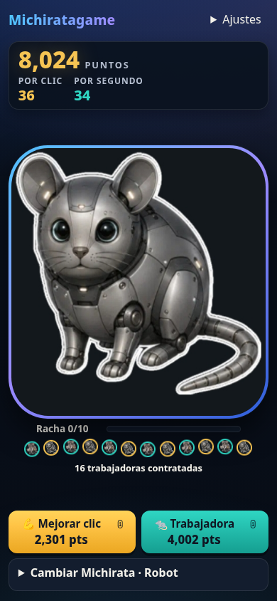

# Michiratagame 🐀

Un clicker absurdo: toca a una rata con cara de gato, escucha su «ñiii», compra mejoras y desbloquea Michiratas con poderes. Sin compras con dinero real ni suscripciones.

Proyecto de una comunidad de amigos, desarrollado con ayuda de IA. Código y recursos del proyecto disponibles bajo [licencia MIT](LICENSE).



## Qué incluye

- Juego adaptable a teléfono y PC, con contador y compras siempre visibles.
- Seis skins con poderes, trabajadoras automáticas y multiplicadores cada diez niveles.
- Sonido sintetizado, partículas y stickers animados; se pueden silenciar, apagar o descartar con un gesto horizontal.
- Guardado local de la partida.
- Backend con contador de jugadores activos, nombres públicos y tablero de récords persistente en SQLite.

## Ejecutarlo

Requiere Node.js 24 o posterior y npm. `.nvmrc` selecciona Node 24.

```bash
git clone https://github.com/Naraku86/michiratagame.git
cd michiratagame
npm ci
npm run build
npm start
```

Abre **http://127.0.0.1:4174**. El servidor entrega el juego y la API; no necesitas claves, cuentas ni servicios externos.

Para desarrollar, deja `npm start` funcionando y abre otra terminal:

```bash
npm run dev
```

Vite muestra su dirección y redirige `/api` al backend de 4174. Si modificas el backend, reinicia `npm start`.

```bash
npm test
npm run build
```

`npm run preview` solo sirve el frontend: para nombres, presencia y tablero utiliza `npm start`.

## Datos y despliegue

- El servidor escucha en `127.0.0.1:4174`. Para exponerlo usa un proxy inverso o un túnel; sirve frontend y API bajo el mismo dominio.
- `PORT` cambia el puerto. `MICHI_DATA_DIR` cambia la carpeta de la base de datos (predeterminada: `data/`).
- La base `data/community.sqlite` contiene nombres, récords y sesiones; no se incluye en Git. Conserva esa carpeta entre despliegues y respáldala con el servidor detenido, incluidos los archivos SQLite auxiliares si existen.
- La partida se guarda en el navegador, no en el servidor. No se sincroniza entre dispositivos y no genera puntos cuando la pestaña está oculta.
- «Activo» significa que un navegador visible envió presencia durante el último minuto. Se actualiza cada veinte segundos; varias pestañas comparten identidad mediante una cookie.
- El tablero conserva el mejor saldo comunicado, incluso después de gastar o reiniciar. Los máximos aún no enviados pueden perderse al cerrar.
- Borrar cookies, cambiar de dispositivo o cambiar de dominio crea otra identidad. Los nombres no son cuentas verificadas y pueden repetirse.
- Las puntuaciones son declaradas por el cliente: la clasificación de esta demo no es resistente a trampas.

## Estructura

| Carpeta | Contenido |
| --- | --- |
| `src/` | Economía, interfaz, audio, guardado, conexión comunitaria y pruebas |
| `server/` | Backend HTTP, SQLite y pruebas de integración |
| `public/assets/` | Imágenes de las seis Michiratas y dos WebP animados |
| `arte/` | Vista de la demo y arte conceptual; el concepto no describe funciones implementadas |
| `docs/` | Contexto histórico, investigación y planes de desarrollo |

Votaciones, moderación con IA y cuentas con proveedores externos son ideas futuras. Los documentos históricos pueden describir versiones anteriores; para ejecutar la versión actual utiliza este README.

## Contribuir

Abre un [issue](https://github.com/Naraku86/michiratagame/issues) con el problema o la idea, o envía un pull request. Consulta [CONTRIBUTING.md](CONTRIBUTING.md).

## Licencia e imágenes

[MIT](LICENSE). Incluye el código y los recursos originales del proyecto. Las dependencias conservan sus propias licencias. La licencia no concede derechos sobre marcas o elementos de terceros que aparezcan en imágenes.

Las imágenes de Michirata y sus variantes fueron aportadas por la comunidad; el arte conceptual se generó con IA. Se conservaron los WebP animados originales. Más detalles en [public/assets/README.md](public/assets/README.md).
